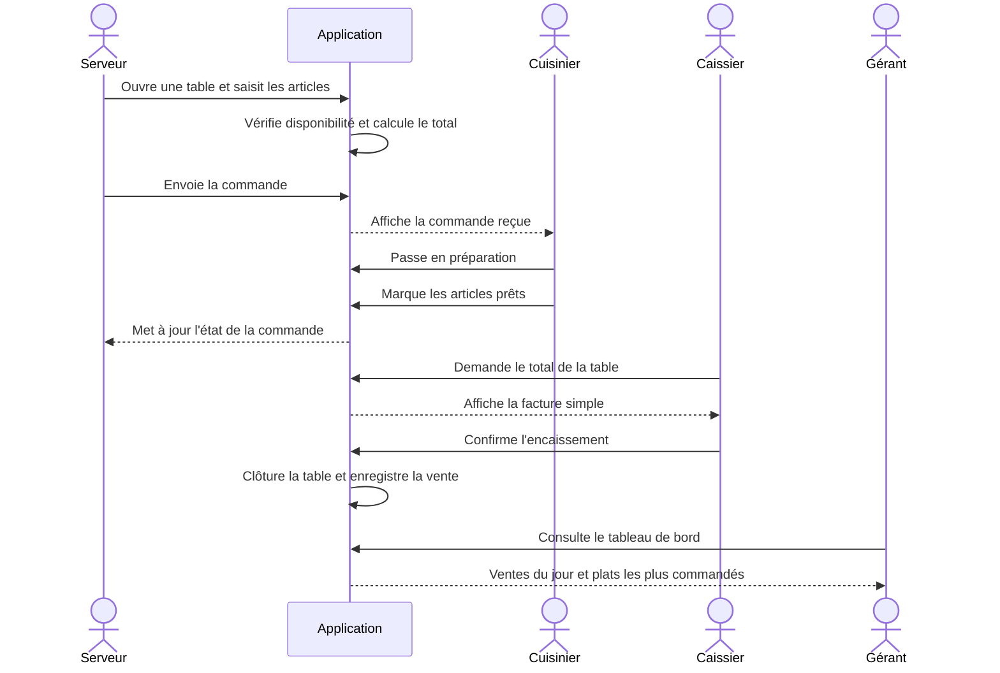

# 02 — Acteurs et interactions

## Acteurs

| Acteur | Responsabilités principales |
|---|---|
| Serveur | Ouvrir une table, consulter le menu, saisir et envoyer une commande, consulter son état |
| Cuisinier | Voir les commandes reçues, démarrer la préparation, marquer les éléments prêts |
| Caissier | Consulter le total, encaisser, éditer la facture et clôturer la table |
| Gérant | Gérer plats/prix/disponibilité, consulter ventes et plats les plus commandés |

## Flux principal

## Règles d'interaction
- Le serveur ne peut envoyer que des articles disponibles.
- Le cuisinier ne voit que les commandes envoyées en cuisine.
- Le caissier ne clôture qu'une table payée.
- Le gérant peut modifier le menu, mais un prix déjà présent dans une commande ne change pas rétroactivement.
- Toute action sensible doit être identifiable par l'utilisateur connecté.
