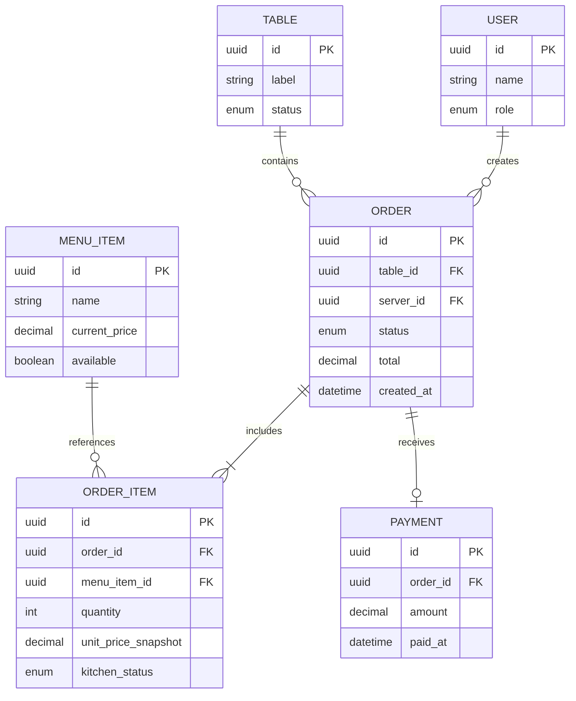

# 03 — Architecture cible

## Choix proposés à valider
- Application web responsive utilisable sur téléphone, tablette et ordinateur.
- API REST séparant l'interface et les règles métier.
- Base relationnelle PostgreSQL pour garantir la cohérence des commandes et factures.
- Authentification par session ou jeton, avec autorisations par rôle.
- Tests unitaires des règles métier et tests d'acceptation des parcours principaux.

Ce choix est adapté à un restaurant : plusieurs postes doivent voir rapidement le même état, les données sont structurées et la facturation exige des transactions fiables. Une architecture monolithique modulaire est préférée au démarrage pour rester simple à déployer et maintenir.

## Modèle de données minimal



## Statuts
- Table : `libre`, `occupée`, `à encaisser`.
- Commande : `brouillon`, `envoyée`, `en préparation`, `prête`, `payée`, `clôturée`, `annulée`.
- Article cuisine : `reçue`, `en préparation`, `prête`.

## Arborescence cible

```text
chez-mama-rita/
├── README.md
├── AGENTS.md
├── journal.md
├── publication-linkedin.md
├── docs/
├── tests/
├── app/                  # interface web par rôle
├── server/               # API et règles métier
├── database/             # schéma et migrations
└── config/               # configuration sans secrets
```

Les dossiers applicatifs sont une cible future : ils ne sont pas créés dans cette étape de préparation.
